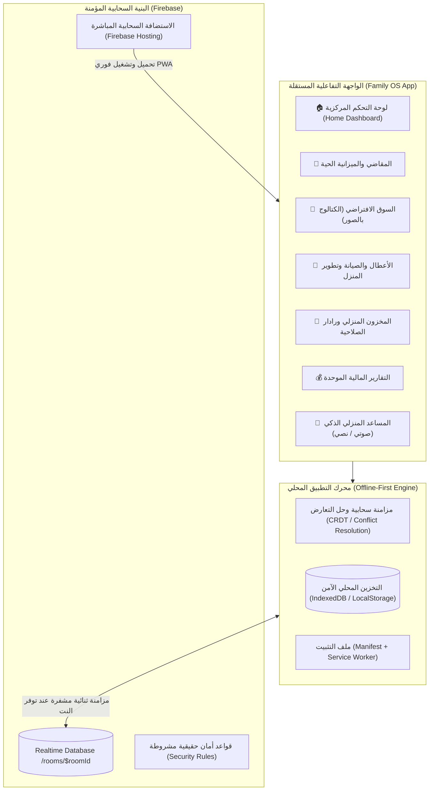

# 📋 خطة العمل التنفيذية المحدثة والشاملة: نظام الإدارة المنزلي الذكي (Family OS)

> [!IMPORTANT]
> **مبدأ التنفيذ المعتمد:** 
> سيتم بناء المشروع وتطويره بالكامل في **ملفات جديدة ومستقلة** مع الاحتفاظ بالملف الأصلي كمرجع أساسي، لضمان عدم المساس بالنسخة القديمة واستقرار كل مرحلة قبل اعتمادها.

---

## 🏛️ الرؤية المعمارية لنظام تشغيل المنزل (Architecture)

---

## 🗓️ مراحل التنفيذ وجدول الأعمال (Master Roadmap)

### 📌 المرحلة 0: مراجعة وتثبيت المواصفات وتجهيز المشروع الجديد (Baseline & Setup)
*الهدف: إنشاء البيئة الجديدة النظيفة، استخلاص الميزات الناجحة من الملف القديم، وتأسيس الهيكل البرمجي الجديد.*

1. **إنشاء مجلد وملفات المشروع الجديد:**
   - ملف التطبيق الجديد المنفصل (مثل: `index.html` داخل مجلد مخصص).
   - توثيق الثوابت وقوائم الأقسام الأساسية والألوان.
2. **محرك البيانات المحلي (Offline-First State Engine):**
   - تصميم بنية البيانات (`State Schema`) لتستوعب: المقاضي، الأعطال، الكتالوج، المخزون، وسجل النشاطات.
   - تهيئة افتراضية مانعة للأخطاء (تجاوز مشكلة `S.cats` غير المعرفة).
3. **آلية مزامنة ذكية بدون تعارض (Conflict Resolution):**
   - نظام يعتمد على الطوابع الزمنية (`Timestamp`) لكل عنصر على حدة، بحيث لو أضاف شخص غرضاً أثناء انقطاع النت في السوبرماركت، يُدمج تلقائياً مع السحابة دون الكتابة فوق بيانات الآخرين.
4. **تجهيز PWA والتثبيت الفوري:**
   - تجهيز `manifest.json` و `sw.js` ليعمل التطبيق كتطبيق هاتف أصلي بدون شريط المتصفح ويعمل عند انقطاع الإنترنت.

---

### 📌 المرحلة 1: التأسيس السحابي والأمان الحقيقي (Firebase & Hardened Security)
*الهدف: نقل الأمان من مجرد فحص PIN في المتصفح إلى أمان سحابي حقيقي في قواعد بيانات Firebase.*

1. **عزل الغرف العائلية التلقائي:**
   - توليد رابط دخول ذكي لكل عائلة (`#room=xxxx-xxxx`) حتى لا تتداخل بيانات العائلات المختلفة في الغرفة الافتراضية.
   - زر "مشاركة رابط دعوة العائلة" للدخول الفوري لبقية أفراد البيت دون كتابة أي إعدادات.
2. **قواعد أمان Firebase الموثوقة (`database.rules.json`):**
   - حماية مسار الغرف بحيث لا يمكن مسح الغرفة كلياً أو العبث ببياناتها دون تطابق المعرفات.
   - عزل وحماية مسار مفاتيح الذكاء الاصطناعي (`/ai/$roomId`).
3. **إعداد الاستضافة السحابية (Firebase Hosting):**
   - نشر النسخة الجديدة برابط مجاني رسمي (مثل: `https://family-requests-9e431.web.app`).

---

### 📌 المرحلة 2: لوحة التحكم المركزية (Home Dashboard)
*الهدف: الواجهة الرئيسية الموحدة التي تلخص حالة المنزل في شاشة واحدة أنيقة وسريعة.*

1. **بطاقات النبض المنزلي السريع (Quick Pulse Cards):**
   - عداد المقاضي المتبقية والحرجة 🔥.
   - تنبيه الأعطال الطارئة التي تنتظر الإصلاح 🚨.
   - مؤشر الميزانية والمصروف الإجمالي.
   - تنبيهات المنتجات التي شارفت صلاحيتها على الانتهاء ⚠️.
2. **أزرار الإجراءات السريعة (Quick Actions):**
   - إضافة غرض للمقاضي بنقرة زر.
   - تسجيل عطل أو فني صيانة.
   - فتح "وضع السوبرماركت" السريع.

---

### 📌 المرحلة 3: الكتالوج الافتراضي (السوق المدمج بالصور والأسعار)
*الهدف: توفير مكتبة تضم أكثر من 120 غرضاً أساسياً وثانوياً مصوراً لإضافتها بنقرة واحدة.*

1. **بنك الأصناف المصور (Visual Pantry Database):**
   - تصنيف مرئي: (ألبان، خضار وفواكه، مخبز، مجمدات ولحوم، عطار ونواشف، منظفات، صيدلية).
   - صور مصغرة عالية الجودة وخفيفة جداً، مع أسعار افتراضية مناسبة.
2. **التوريد الفوري (1-Tap Add):**
   - نقرة واحدة على صورة المنتج تضيفه مباشرة إلى قائمة المقاضي بالقسم والكمية والسعر التقديري.
3. **إدارة وتخصيص الكتالوج:**
   - إمكانية تعديل الأسعار لتناسب السوق المحلي، وإضافة منتجات خاصة بالأسرة بالصور.

---

### 📌 المرحلة 4: سجل أعطال وصيانة وتطوير المنزل (Home Maintenance & Upgrades)
*الهدف: متابعة تصليح الأعطال، تنظيم الفنيين، وتوثيق أفكار تحسين وتجديد البيت.*

1. **سجل الأعطال الذكي (Issues Tracker):**
   - إضافة عطل: (الموقع: مطبخ/حمام/صالة، الوصف، مستوى الإلحاح: طارئ 🚨 / عادي 🔧).
   - تعيين المسؤول (أحد أفراد الأسرة أو فني خارجي).
2. **ربط قطع الغيار بقائمة المقاضي:**
   - زر لتحويل المواد المطلوبة للإصلاح (مثلاً: شريط سباكة، لمبة، فلتر) إلى قائمة المشتريات فوراً.
3. **لوحة تطوير وتجديد المنزل (Home Wishlist):**
   - رصد خطط التحسين طويلة الأمد (شراء جهاز جديد، طلاء غرفة) وتكلفتها التقديرية.

---

### 📌 المرحلة 5: المخزون ورادار الصلاحية والمالية الموحدة
*الهدف: منع هدر الطعام ومعرفة المتوفر في البيت وضبط الميزانية.*

1. **شاشة المخزون الحالي (Home Pantry):**
   - تحويل المقاضي التي تم شراؤها إلى "المخزون الحالي" بنقرة واحدة.
2. **رادار تواريخ الصلاحية (Expiry Radar):**
   - تنبيهات بصرية للأغذية والأدوية قبل انتهاء صلاحيتها بأيام.
3. **التقرير المالي العائلي الموحد:**
   - رسم بياني يدمج مصاريف المشتريات + فواتير الأعطال لمعرفة المصروف الحقيقي بدقة.

---

### 📌 المرحلة 6: المساعد الذكي الميداني والصوتي (AI Home Agent)
*الهدف: التفاعل السلس والميداني في السوبرماركت والمنزل.*

1. **وضع السوبرماركت الميداني (In-Store Mode):**
   - واجهة شطب سريعة بيد واحدة وحاسبة فورية لحساب الفاتورة قبل الكاشير.
2. **"ماذا نطبخ اليوم؟":**
   - اقتراح وجبات غداء وعشاء بناءً على ما في المخزن وتواريخ الصلاحية الأقرب.
3. **المساعد الصوتي المباشر:**
   - إملاء المقاضي أو الأعطال بالعامية لفرزها وإضافتها آلياً.

---

## 🏁 الخطوة القادمة:
سنبدأ في إنشاء **المشروع الجديد كلياً**، وسنقوم بإنشاء ملف `index.html` الجديد وملفات Firebase محلياً لننطلق في **المرحلة 0 والمرحلة 1**.
